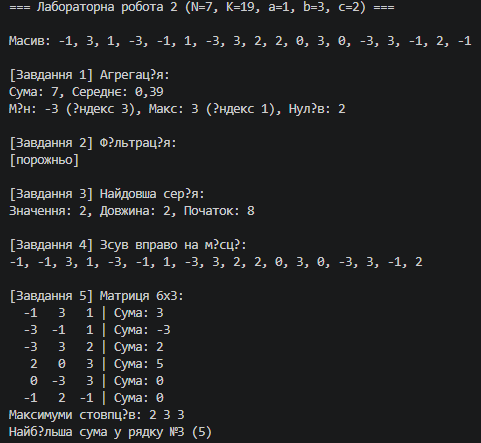

| Вхідні дані | Завдання | Очікувана поведінка | Отриманий результат |
| :--- | :--- | :--- | :--- |
| **Порожній масив** (`length = 0`) | 1–4 | Безпечне завершення без винятків, виведення повідомлення про відсутність даних. | Успішно спрацьовує умова `arr.Length == 0`, програма не падає з помилкою. |
| **Один елемент** (`length = 1`) | 1–4 | Коректне визначення суми/мін/макс, серія довжиною 1, зсув залишає масив незмінним. | Цикли обробляють єдиний елемент без виходу за межі (`IndexOutOfRangeException` відсутній). |
| **Усі елементи однакові** | 1, 3 | Мін/макс знайдено правильно, найдовша серія охоплює всю довжину масиву. | Змінна `cLen` коректно дораховується до кінця, початковий індекс серії рівний `0`. |
