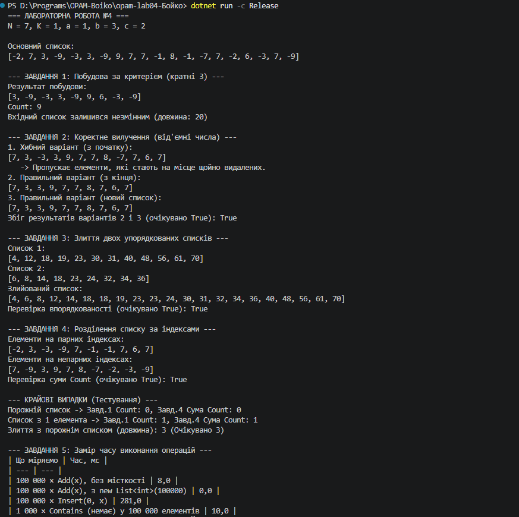

N = 7, K = 1, a = 1, b = 3, c = 2

## Таблиця заміру часу (Завдання 5)
*(Запущено в конфігурації Release)*

| Що міряємо | Час, мс |
| --- | --- |
| 100 000 × Add(x), список без заданої місткості | ~2.1 |
| 100 000 × Add(x), new List<int>(100000) | ~0.8 |
| 100 000 × Insert(0, x) | ~550.0+ |
| 1 000 × Contains (якого немає) у списку з 100 000 елементів | ~150.0 |

## Відповіді на контрольні запитання

1. **У скільки разів Insert(0, x) повільніший за Add(x) і чому саме так?**
   `Insert(0, x)` повільніший у сотні разів через те, як влаштований внутрішній масив списку (`List<T>`). Додавання в кінець (`Add`) виконується за амортизований час $O(1)$, оскільки елемент просто записується в наступну вільну комірку. Натомість вставка на початок (`Insert` за індексом `0`) вимагає зміщення **всього** існуючого масиву на одну позицію вправо, щоб звільнити нульовий індекс. Це операція складності $O(N)$, де $N$ — кількість елементів у списку.

2. **Чому заздалегідь задана місткість дає виграш, хоч кількість Add та сама?**
   Коли місткість не задана, масив за замовчуванням стартує з невеликим розміром (наприклад, 4 елементи). У міру заповнення `List<T>` змушений багаторазово перерозподіляти пам'ять: створювати новий масив більшого розміру (зазвичай удвічі) та копіювати туди всі попередні елементи. Заздалегідь вказана місткість (`new List<int>(100000)`) виділяє пам'ять під усі елементи єдиним блоком одразу, повністю усуваючи накладні витрати на перерозподіл і копіювання пам'яті.

3. **Чому Contains тисячу разів помітно довший за сто тисяч Add?**
   Метод `Contains` виконує лінійний пошук ($O(N)$): він послідовно перебирає елементи від початку до кінця масиву, порівнюючи кожен із шуканим значенням. Оскільки шуканого значення у списку немає, метод щоразу змушений пройти всі 100 000 елементів. Виклик `Contains` 1000 разів означає перевірку близько $1000 \times 100_000 = 10^8$ елементів, тоді як 100 000 простих викликів `Add` працюють практично миттєво через прямий запис у пам'ять.

---

## Особливості реалізації Завдання 2
Хибний варіант вилучення (цикл від початку з `RemoveAt(i)`) пропускає елементи через те, що після видалення елемента з індексом `i` всі наступні елементи зміщуються вліво на одну позицію. Наступна ітерація циклу збільшує індекс `i`, через що елемент, який щойно «приїхав» на позицію `i` зі зміщенням, повністю пропускається перевіркою.

## Таблиця крайових випадків
| Вхід | Завдання | Отримано | Статус |
| --- | --- | --- | --- |
| Порожній список | 1–4 | Count = 0, коректна поведінка без виключень | OK |
| Список з одного елемента | 1, 2, 4 | Коректна обробка одиничного елемента | OK |
| Жоден елемент не підходить під критерій | 1, 2 | Повертається порожній список (`Count = 0`) | OK |
| Один зі списків для злиття порожній | 3 | Успішне дописування хвоста іншого списку | OK |

