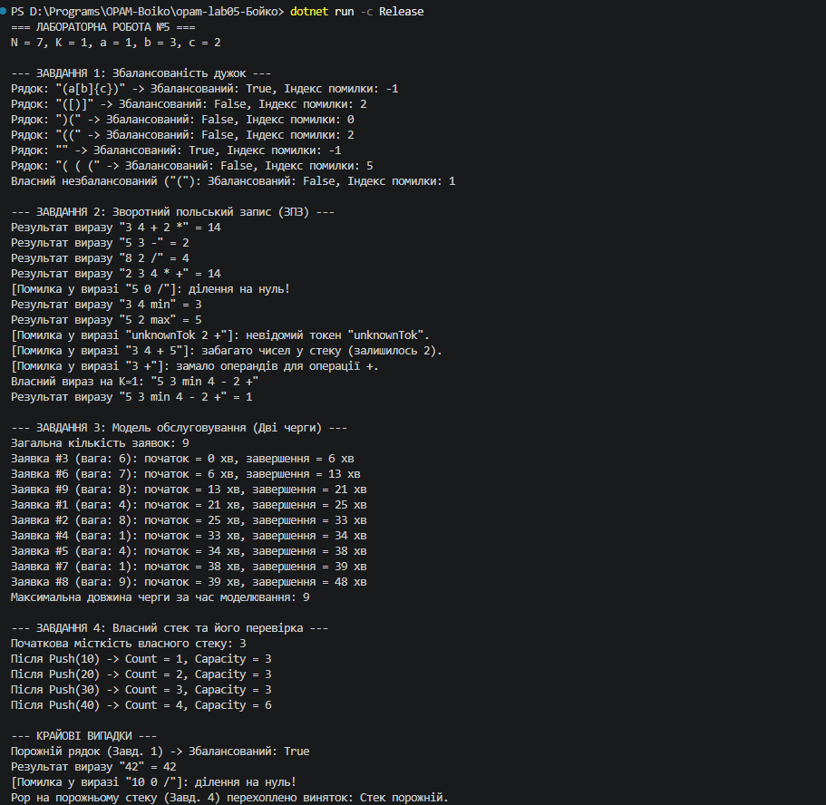

N = 7, K = 1, a = 1, b = 3, c = 2

## Результати обов'язкових тестів

### Завдання 1 (Дужки та індекс помилки)
- `"(a[b]{c})"` → Збалансований: True, Індекс: -1
- `"([)]"` → Збалансований: False, Індекс: 2
- `")("` → Збалансований: False, Індекс: 0
- `"(("` → Збалансований: False, Індекс: 2
- `""` (порожній) → Збалансований: True, Індекс: -1
- **Власний незбалансований рядок** для $K = 1$ (`"("`): Збалансований: `False`, індекс помилки: `1` (непотрібний відкритий елемент наприкінці).

### Завдання 2 (Зворотний польський запис)
- `"3 4 + 2 *"` → `14`
- `"5 3 -"` → `2`
- `"8 2 /"` → `4`
- `"2 3 4 * +"` → `14`
- `"5 0 /"` → Повідомлення про помилку: *ділення на нуль*, падіння програми немає.
- **Власний вираз на $K = 1$** з трьома операціями (`min`, `-`, `+`): `"5 3 min 4 - 2 +"` → Результат: `1`.

---

## Вивід Count і Capacity (Завдання 4)
Початкова місткість: `K % 4 + 2 = 3`. Кількість викликів Push: `K % 4 + 3 = 4`.
- Після Push(10) -> Count = 1, Capacity = 3
- Після Push(20) -> Count = 2, Capacity = 3
- Після Push(30) -> Count = 3, Capacity = 3
- Після Push(40) -> Count = 4, Capacity = 6 *(відбулося подвоєння масиву)*

---

## Завдання 5 · Обґрунтування вибору структур
1. **Завдання 1 (Збалансованість дужок):** Використовується саме стек, оскільки остання відкрита дужка повинна закриватися першою (LIFO — Last In, First Out). Якби замість стека взяли список, довелося б постійно вручну шукати та видаляти елементи з довільних позицій, що порушило б логіку вкладеності.
2. **Завдання 2 (Зворотний польський запис):** Потрібен стек, тому що оператори застосовуються до щойно перед тим обчислених операндів (найближчих праворуч чисел). Список не зміг би забезпечити автоматичне витягування останніх доданих чисел у зворотному порядку без складного ручного керування індексами.
3. **Завдання 3 (Модель обслуговування):** Використовується черга (FIFO — First In, First Out), оскільки заявки обслуговуються в порядку їх надходження (хто перший прийшов, той перший обслуговується). Стек тут призвів би до принципу LIFO (штучного пріоритету останніх заявок), що суперечить справедливому обслуговуванню в черзі.

### Порівняння Queue.Dequeue() та List.RemoveAt(0)
Метод `Queue.Dequeue()` працює за амортизований час $O(1)$, оскільки черга усередині побудована як циклічний буфер (або масив із вказівниками початку й кінця): для вилучення елемента з початку достатньо змістити індекс голови черги, не переміщуючи решту елементів у пам'яті. 
Натомість `List.RemoveAt(0)` працює за час $O(N)$, бо видалення елемента з нульового індексу списку вимагає физичного зміщення всіх інших $N - 1$ елементів масиву ліворуч на одну позицію. Згідно із замірами з Лабораторної роботи №4, операції зі зміщенням масиву (як-от `Insert(0, x)`) є на кілька порядків дорожчими за прямий доступ.

---

## Таблиця крайових випадків
| Вхід | Завдання | Очікувано | Отримано |
| --- | --- | --- | --- |
| Порожній рядок | 1, 2 | Збалансований (true) / Повідомлення про порожній вираз | Коректно оброблено |
| Вираз з одного числа | 2 | Повернення цього ж числа | Коректно оброблено (`42`) |
| Ділення на нуль | 2 | Повідомлення про помилку без винятку | Перехоплено, програма не впала |
| Pop на порожньому стеку | 4 | Виняток InvalidOperationException | Успішно перехоплено у блоці try-catch |

