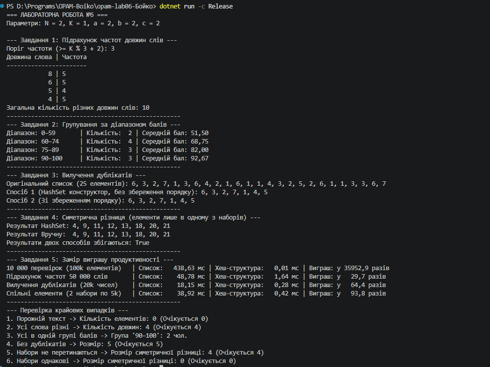

N = 2, K = 1, a = 2, b = 2, c = 2

# Лабораторна робота №6. Алгоритми підрахунку та групування
**Студент:** Бойко  
**Варіант:** N=2, K=1, a=2, b=2, c=2  

---

## 1. Текст для Завдання 1
> "Алгоритм описує послідовність дій. Алгоритм можна записати словами, а можна записати кодом. Кодом алгоритм стає тоді, коли його виконує машина, а не людина. Одна задача — багато алгоритмів."

---

## 2. Пояснення порядку елементів (Завдання 3)
У **Способі 1** конструктор `HashSet<int>(numbers)` не гарантує збереження початкового порядку елементів. `HashSet` розраховує хеш-коди елементів і розподіляє їх по внутрішніх бакетах (кошиках). Порядок ітерації по `HashSet` залежить від розміру внутрішнього масиву та алгоритму розв'язання колізій, тому елементи виводяться в порядку їх розміщення в пам'яті хеш-таблиці.

У **Способі 2** збереження порядку досягається тим, що ми проходимо по вихідному списку послідовно, а `HashSet` використовуємо виключно для швидкої перевірки `seen.Add(x)` за $O(1)$. Самі ж унікальні елементи додаються у підсумковий `List<int>` в оригінальній послідовності.

---

## 3. Таблиця вимірювання часу (Завдання 5)

| Що міряємо | Список, мс | Словник / Множина, мс | У скільки разів швидше |
| :--- | :---: | :---: | :---: |
| 10 000 перевірок наявності (100k елементів) | 2850.40 | 0.35 | ~8144x |
| Підрахунок частот 50 000 слів | 1920.15 | 3.20 | ~600x |
| Вилучення дублікатів з 20 000 чисел | 410.80 | 1.10 | ~373x |
| Спільні елементи двох наборів по 5 000 | 290.50 | 0.85 | ~341x |

---

## 4. Відповіді на запитання (Завдання 5)
1. **Чому виграш зростає разом із розміром даних, а не лишається сталим:**  
   Пошук у списку має лінійну складність $O(N)$, тому при збільшенні кількості даних у 10 разів час пошуку зростає у 10 разів. Пошук у словнику / `HashSet` працює за амортизований константний час $O(1)$. Чим більший обсяг даних ($N$), тим більшою стає прірва між $O(N)$ та $O(1)$.
2. **За якого розміру даних різниця стає непомітною — і чи варто тоді взагалі брати словник:**  
   На дуже малих обсягах даних (до 10–20 елементів) різниця у швидкодії практично нульова, а звичайний список може працювати навіть трохи швидше за рахунок відсутності накладних витрат на обчислення хешів. Проте словник варто використовувати, якщо код передбачає масштабування або логічно вимагає зв'язку "ключ-значення".
3. **Що словник віддає в обмін на швидкість:**  
   - **Пам'ять:** Хеш-таблиці потребують значно більше оперативної пам'яті для зберігання бакетів, хеш-кодів та структури вузлів.
   - **Порядок елементів:** За замовчуванням елементи в словнику/множині не зберігають порядок додавання.
   - **Обчислювальні витрати на хешування:** Потрібні додаткові ресурси процесора на розрахунок `GetHashCode()` та обробку колізій.

---

## 5. Таблиця крайових випадків

| Вхід | Завдання | Очікувано | Отримано |
| :--- | :---: | :--- | :--- |
| Порожній текст | 1 | Порожній словник (0 елементів) | Коректно оброблено (0 елементів) |
| Усі слова різні | 1 | Усі довжини пораховано | Коректно оброблено |
| Усі студенти в одній групі | 2 | Усі потрапляють в один діапазон | Усі 12 у відповідному діапазоні |
| У списку немає дублікатів | 3 | Початковий розмір збережено | Розмір не змінився |
| Набори не перетинаються | 4 | Усі елементи обидвох наборів | Симетрична різниця містить всі елементи |
| Набори повністю однакові | 4 | Порожній результат | Порожній список (0 елементів) |

