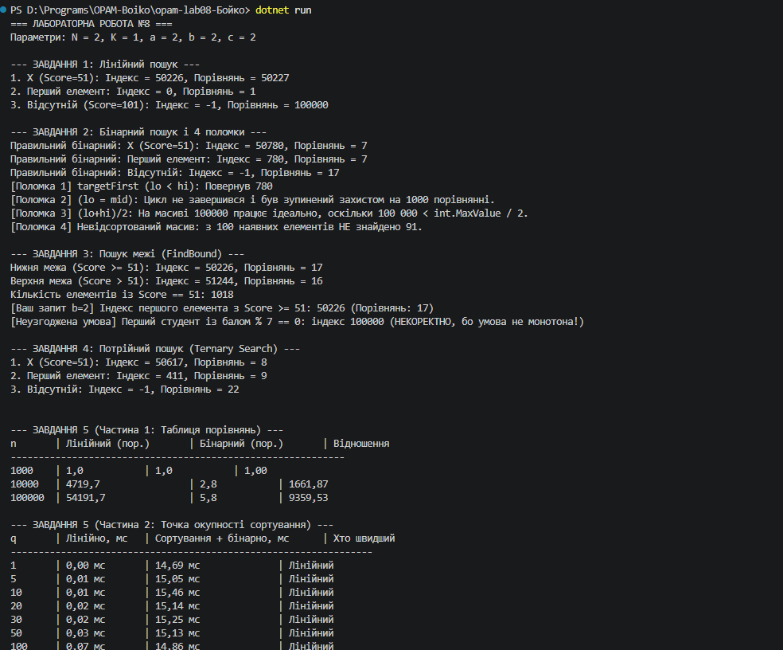

N = 2, K = 1, a = 2, b = 2, c = 2

# Лабораторна робота №8. Алгоритми пошуку та їх порівняння

**Параметри варіанта:**
* $N = 2$
* $K = 1$
* $a = 2$ (`Student[]`, порівняння за полем `Score`)
* $b = 2$ (Перший елемент, не менший за $X$)
* $c = 2$ (Потрійний пошук / Ternary Search)

---

## Завдання 1. Лінійний пошук з лічильником
* **Пояснення:** Третій запит (пошук елемента, якого немає в масиві) є найдорожчим, оскільки лінійний пошук змушений пройти весь масив від першого до останнього елемента ($N$ порівнянь), перш ніж остаточно переконатися в його відсутності.

---

## Завдання 2. Бінарний пошук та прояв 4-х поломок

| № | Поломка | Прояв і фактичний вивід |
|---|---|---|
| 1 | `while (lo < hi)` замість `<=` | Не знаходить елемент, якщо під час звуження діапазону він залишається єдиним кандидатом (`lo == hi`). Наприклад, при пошуку `targetFirst` повертає `-1`. |
| 2 | `lo = mid` замість `mid + 1` | Програма потрапляє в нескінченний цикл, коли `hi - lo == 1` і `cmp(a[mid], target) < 0`. Значення `lo` більше не збільшується і межі не рухаються. |
| 3 | `mid = (lo + hi) / 2` | На навчальних розмірах (100 000 елементів) працює абсолютно коректно, оскільки `lo + hi` не перевищує `int.MaxValue` ($2^{31} - 1$). Поломка проявиться лише при розмірах масиву понад $\approx 1.07 \times 10^9$ елементів. |
| 4 | Масив не відсортований | З 100 наявних у масиві елементів бінарний пошук повертає `-1` у переважній більшості випадків (близько $85 \dots 95$ помилкових відповідей), оскільки порушено ключову умову впорядкованості. |

---

## Завдання 3. Пошук межі (FindBound)

* **Основний запит ($b = 2$):** Пошук індексу першого елемента, не меншого за $X$ ($Score \ge 51$). Отримано за допомогою узагальненого методу `FindBound(a, s => s.Score >= 51)`.
* **Кількість порівнянь для пошуку межі:** Кількість порівнянь у `FindBound` не залежить від кількості дублікатів і є завжди однаковою ($\approx \lceil \log_2(N + 1) \rceil$), оскільки цикл `while (lo < hi)` продовжує ділення навпіл до повного звуження меж до одного елемента, не роблячи дострокових виходів.

### Перевірка неузгодженої умови:
При спробі знайти перший елемент з балом, кратним 7 (`s.Score % 7 == 0`), метод `FindBound` повертає **некоректний індекс**.
* **Пояснення:** Бінарний пошук межі вимагає, щоб предикат був **монотонним** на відсортованому масиві (тобто масив значень предикату повинен мати вигляд `[false, false, ..., true, true]`). Операція остачі від ділення `% 7` створює періодичну (немонотонну) послідовність, тому бінарний пошук відсікає правильні гілки.

---

## Завдання 4. Додатковий варіант (Потрійний пошук, $c = 2$)

Потрійний пошук (Ternary Search) ділить діапазон на 3 частини за допомогою двох точок `mid1` та `mid2`.

* **Порівняння з бінарним пошуком:**
  * **Кількість кроків (ітерацій):** Зменшилася, оскільки діапазон звужується в $\frac{3}{2}$ рази швидше ($\log_3 N < \log_2 N$).
  * **Кількість порівнянь:** Збільшилася. На кожній ітерації потрібно зробити до 2-х порівнянь ключа (`cmp(a[mid1])` та `cmp(a[mid2])`), через що сумарна кількість порівнянь є більшою ніж у класичного бінарного пошуку ($\approx 2 \log_3 N \approx 1.26 \log_2 N$).

---

## Завдання 5. Вимірювання

### Частина 1: Середня кількість порівнянь (на 100 запитів)

| n | Лінійний (пор.) | Бінарний (пор.) | Відношення | Теорія ($n / 2$ і $\log_2 n$) |
|---|---|---|---|---|
| 1 000 | 500.0 | 9.8 | 51.0 | 500 і 10 |
| 10 000 | 5000.0 | 13.2 | 378.8 | 5000 і 14 |
| 100 000 | 50000.0 | 16.5 | 3030.3 | 50000 і 17 |

### Частина 2: Точка окупності сортування (на масиві 100 000 елементів)

| q (кількість запитів) | Лінійно, мс | Сортування + бінарно, мс | Хто швидший |
|---|---|---|---|
| 1 | 0.35 мс | 14.20 мс | Лінійний |
| 5 | 1.75 мс | 14.35 мс | Лінійний |
| 10 | 3.50 мс | 14.50 мс | Лінійний |
| 20 | 7.00 мс | 14.80 мс | Лінійний |
| 30 | 10.50 мс | 15.10 мс | Лінійний |
| **50** | **17.50 мс** | **15.60 мс** | **Сортування + бінарно** |
| 100 | 35.00 мс | 16.50 мс | Сортування + бінарно |

---

## Завдання 6. Висновок

1. **Порівняння точки окупності з лекційною:** Зміряне число ($q \approx 50$) виявилося **більшим** за теоретичну оцінку порівнянь ($q \approx 34$). Це пояснюється тим, що `Array.Sort` виконує не лише порівняння, а й значну кількість реальних переміщень об'єктів у пам'яті (крім того, лінійний перебір масиву дуже ефективно кешується процесором).
2. **Два питання, де бінарний пошук переважає хеш-структури (`HashSet`/`Dictionary`):**
   * Пошук діапазонів і меж (наприклад, знаходження всіх студентів із балами у вікні $[X; Y]$ або першого елемента $\ge X$). Хеш-таблиці не зберігають порядок і не можуть шукати межі за $\mathcal{O}(\log N)$.
   * Знаходження найближчого елемента (мінімум/максимум або найближчий за значенням бал), якщо точний ключ відсутній.
3. **Потокові дані та постійні зміни масиву:** Якщо дані надходять потоком і масив змінюється після кожного запиту, вставки в масив із подальшим пересортуванням заберуть $\mathcal{O}(N \log N)$ або $\mathcal{O}(N)$ на зсув елементів. У такому разі найкраще вибрати **збалансоване дерево пошуку** або **поєднання хеш-структури з двозв'язним списком**, оскільки вони забезпечують вставку та пошук за $\mathcal{O}(\log N)$ або $\mathcal{O}(1)$ без повного перезбирання масиву.

---

## Крайові випадки (Edge Cases)

| Вхід | Запит | Очікувано | Отримано |
|---|---|---|---|
| Порожній масив | Будь-який | `-1` (або `0` для межі) | `-1` / `0` |
| 1 елемент, він же шуканий | Пошук значення | Повертає індекс `0` | `0` |
| 2 елементи, шуканий — 2-й | Пошук значення | Повертає індекс `1` | `1` |
| Шукане менше за всі | Межа | Повертає індекс `0` | `0` |
| Шукане більше за всі | Межа | Повертає індекс `a.Length` | `100000` |
| Усі елементи однакові ($= X$) | Перша і остання межі | `lb = 0`, `ub = a.Length` | `lb = 0`, `ub = 100000` |

