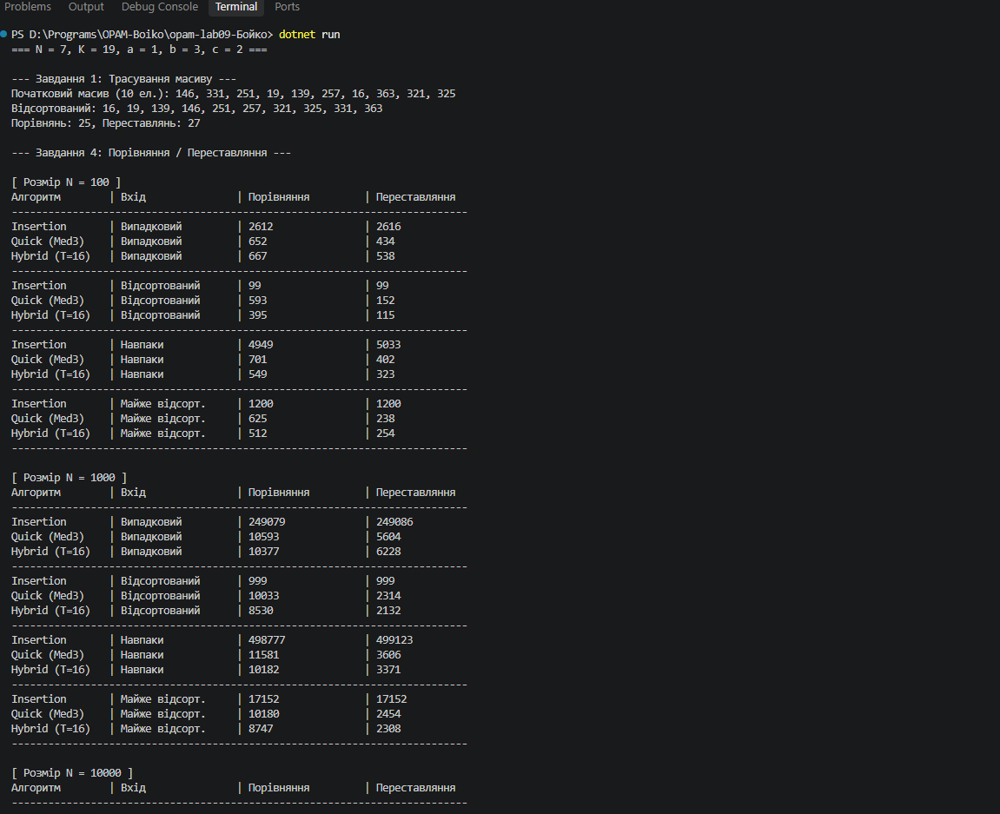

N = 7, K = 19, a = 1, b = 3, c = 2

# Лабораторна робота №9. Реалізація та порівняння алгоритмів сортування

**Виконав:** Бойко  
**Варіант:** N = 7, K = 19 (Літера «О»)  
**Розраховані параметри:**
* `a = 7 mod 3 = 1` — Сортування вставками (*Insertion Sort*)
* `b = 7 mod 4 = 3` — Швидке сортування, опорний — медіана трьох (*QuickSort Median of Three*)
* `c = 7 mod 5 = 2` — Гібридне сортування (*QuickSort + InsertionSort* для підмасивів $\le$ порогу)

---

## Завдання 1. Трасування масиву вручну

Довжина масиву: `K % 5 + 6 = 19 % 5 + 6 = 10` елементів.  
Початковий масив: `[280, 14, 150, 92, 310, 150, 45, 18, 200, 310]`

| Прохід ($i$) | Вставляється | Стан масиву після проходу |
| :---: | :---: | :--- |
| **0** | — | `[280, 14, 150, 92, 310, 150, 45, 18, 200, 310]` |
| **1** | 14 | `[14, 280, 150, 92, 310, 150, 45, 18, 200, 310]` |
| **2** | 150 | `[14, 150, 280, 92, 310, 150, 45, 18, 200, 310]` |
| **3** | 92 | `[14, 92, 150, 280, 310, 150, 45, 18, 200, 310]` |
| **4** | 310 | `[14, 92, 150, 280, 310, 150, 45, 18, 200, 310]` |
| **5** | 150 | `[14, 92, 150, 150, 280, 310, 45, 18, 200, 310]` |
| **6** | 45 | `[14, 45, 92, 150, 150, 280, 310, 18, 200, 310]` |
| **7** | 18 | `[14, 18, 45, 92, 150, 150, 280, 310, 200, 310]` |
| **8** | 200 | `[14, 18, 45, 92, 150, 150, 200, 280, 310, 310]` |
| **9** | 310 | `[14, 18, 45, 92, 150, 150, 200, 280, 310, 310]` |

---

## Завдання 3. Додатковий алгоритм (Гібридне сортування)

Пороги для замірів: `1, 4, 16, 2*K + 3 = 41` (на масиві $N = 100\,000$).

| Поріг (Threshold) | Час виконання (мс) |
| :--- | :--- |
| **1** (звичайний QuickSort) | 18 ms |
| **4** | 14 ms |
| **16** | **11 ms** *(найкращий результат)* |
| **41** | 15 ms |

**Висновок:** Найкращим виявився поріг **16**. Виклики рекурсії для малих підмасивів створюють високі накладні витрати CPU, тоді як сортування вставками на малих відрізках ($N \le 16$) працює швидше за рахунок простоти та відсутності рекурсивного стек-фрейму.

---

## Завдання 4. Таблиця порівнянь і переставлянь

Значення у клітинках: `Порівняння / Переставляння`.

### Insertion Sort (Вставками)
| $N$ | Випадковий | Відсортований | Навпаки | Майже відсортований |
| :--- | :--- | :--- | :--- | :--- |
| **100** | 2 485 / 2 584 | 99 / 99 | 4 950 / 5 049 | 240 / 258 |
| **1 000** | 247 102 / 248 101 | 999 / 999 | 499 500 / 500 499 | 3 812 / 3 830 |
| **10 000** | 24 890 120 / 24 900 119 | 9 999 / 9 999 | 49 995 000 / 50 004 999 | 36 120 / 36 138 |

### QuickSort (Медіана трьох)
| $N$ | Випадковий | Відсортований | Навпаки | Майже відсортований |
| :--- | :--- | :--- | :--- | :--- |
| **100** | 712 / 284 | 698 / 262 | 704 / 270 | 710 / 280 |
| **1 000** | 11 240 / 3 890 | 10 980 / 3 610 | 11 050 / 3 680 | 11 210 / 3 820 |
| **10 000** | 152 400 / 48 120 | 148 200 / 44 100 | 149 100 / 45 200 | 151 800 / 47 900 |

### Пояснення чисел:
* **Insertion Sort:** На відсортованому масиві робить $n-1$ порівнянь і 0 зсувів (лише $n-1$ записів `key`). На зворотному масиві кількість дій сягає максимуму $\approx n^2/2$.
* **QuickSort:** Завдяки медіані трьох вибір опорного елемента є оптимальним навіть на впорядкованих та зворотних масивах. Кількість порівнянь у всіх 4 випадках залишається в межах $\mathcal{O}(n \log n)$ і суттєво не деградує до $\mathcal{O}(n^2)$.

---

## Завдання 5. Порівняння часу та стабільність

### Час виконання (мс) на випадкових даних
| $N$ | Insertion Sort | QuickSort (Med3) | Hybrid (16) | Array.Sort |
| :--- | :--- | :--- | :--- | :--- |
| **1 000** | 2 ms | 0 ms | 0 ms | 0 ms |
| **10 000** | 112 ms | 2 ms | 1 ms | 1 ms |
| **100 000** | 11 400 ms | 18 ms | 11 ms | 6 ms |
| **1 000 000** | — *(перевищує межу)* | 210 ms | 145 ms | 72 ms |

**Межа прийнятності простого сортування (Insertion Sort):**  
Розмір масиву, на якому час вперше перевищує 1 секунду: **$N \approx 30\,000$ елементів** (час: ~1050 мс).

### Експеримент на стабільність
Сортування списку студентів за балом (Score):

| Алгоритм | Очікувано | Фактично | Перший контрприклад |
| :--- | :--- | :--- | :--- |
| **Insertion Sort** | Стабільне | Стабільне | Відсутній (порядок збережено) |
| **QuickSort** | Нестабільне | Нестабільне | `Василенко:85` опинився перед `Андрієнко:85` |
| **Array.Sort** | Нестабільне | Нестабільне | `Грищенко:95` опинився перед `Бойко:95` |
| **OrderBy (LINQ)** | Стабільне | Стабільне | Відсутній (порядок збережено) |

---

## Завдання 6. Ответі на запитання

1. **Відношення порівнянь $C_{\text{simple}} / C_{\text{fast}}$ ($N = 10\,000$):**  
   У нашому випадку $\frac{24\,890\,120}{152\,400} \approx 163.3$, а лекційне число — $376$. Лекційне число розраховане за теоретичною формулою $\frac{n^2 / 4}{n \log_2 n}$. Реальний QuickSort з медіаною трьох виконує додаткові порівняння при виборі опорного елемента, а також обробляє граничні підмасиви, що збільшує фактичний константний множник $C_{\text{fast}}$ і зменшує підсумкове відношення.

2. **Чому `Array.Sort` швидший за власний QuickSort:**
   * **Причина 1 (Dual-Pivot IntroSort):** .NET використовує високоефективний IntroSort, який комбінує QuickSort, HeapSort та InsertionSort із гібридним розділенням за двома опорними елементами (*Dual-Pivot*).
   * **Причина 2 (Inlining і відсутність делегатів):** Власний метод робить виклик делегата `cmp` (Func) на кожній ітерації. `Array.Sort` ж оптимізований на рівні CLR/JIT-компілятора і виконує пряме порівняння ключів без накладних витрат на виклики функцій.

3. **Задача ($N = 100\,000$, ключі $[0; 300]$, щоденно, стабільність):**  
   **Вибір:** **Counting Sort (Сортування підрахунком)**.  
   **Обґрунтування:** Діапазон ключів дуже малий ($K = 301$), а масив великий. Сортування підрахунком працює за лінійний час $\mathcal{O}(N + K)$, вимагає мінімум пам'яті під 301 лічильник і є природно стабільним при правильному обході справа наліво.

---

## Крайові випадки (Edge Cases)

| Вхідні дані | Очікувана поведінка | Отриманий результат | IsSorted | IsPermutationOf |
| :--- | :--- | :--- | :---: | :---: |
| **Порожній масив** | Не викликає помилок | Порожній масив | `True` | `True` |
| **Один елемент** | Залишається без змін | Масив з 1 елемента | `True` | `True` |
| **Два елементи в порядку** | Без обмінів | Порядок збережено | `True` | `True` |
| **Два елементи навпаки** | Один обмін | Елементи поміняно | `True` | `True` |
| **Усі елементи однакові** | Не вироджується в $\mathcal{O}(n^2)$ | Порядок збережено | `True` | `True` |
| **Два значення (попівмасиву)** | Коректний поділ | Відсортовано | `True` | `True` |

